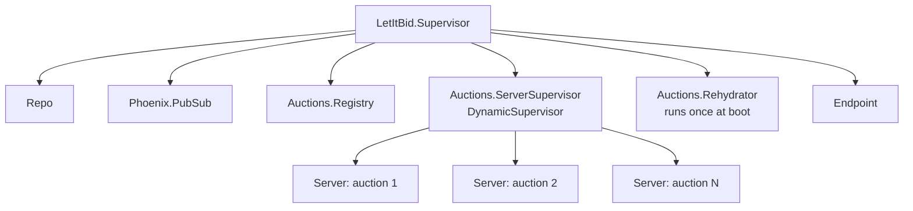
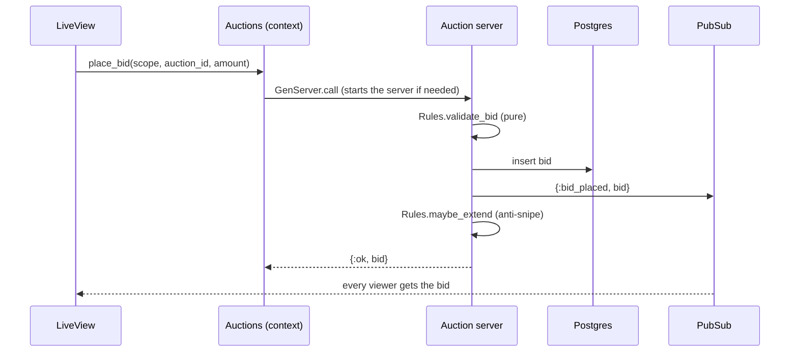

# LetItBid

A live auction house built with Elixir, Phoenix LiveView and OTP.

Every open auction runs as its own supervised process. Bids are applied one at a time, everyone watching sees them instantly, and when an auction process crashes it comes back exactly where it was, because Postgres, not the process, holds the truth. The name is a nod to Erlang's "let it crash" and The Beatles "Let it Be".

> **Status: work in progress.** The auction engine is done and tested: bidding rules, anti-sniping, one process per auction, crash recovery, and restart after a deploy. The LiveView pages (auction list, live auction room, viewer count, a "crash this auction" button) are next.

**Stack:** Elixir 1.20 · OTP 29 · Phoenix 1.8 · LiveView 1.2 · Postgres 18

## What it shows

- **One GenServer per auction**, started under a `DynamicSupervisor` and found by ID through a `Registry`.
- **Concurrent bids, applied in order.** The server for an auction handles one bid at a time, so 200 simultaneous bids can't both win at the same price.
- **Crash recovery.** Kill an auction's process and the supervisor restarts it. It reloads its state from Postgres and keeps the same top bid and end time.
- **Restart after a deploy.** At boot, every open auction gets its server back. An auction that ended while the app was down closes right away.
- **Anti-sniping.** A bid in the last 10 seconds pushes the end back, so nobody wins by bidding in the final second.
- **Real-time updates over PubSub.** Servers broadcast only when something changes: a bid, an extension, a close.

## How it works

### Supervision tree



The order matters. Auction servers need `Repo` and `PubSub`. The Rehydrator needs the `Registry` and `ServerSupervisor`, and runs before the `Endpoint`, so open auctions already have servers when the first request arrives.

### Placing a bid



The code is split into three layers:

| Module | Job |
|---|---|
| `LetItBid.Auctions.Rules` | The bidding and anti-snipe rules as pure functions. No processes, no database. |
| `LetItBid.Auctions.Server` | Puts bids in order, runs the close timer, broadcasts changes. It asks `Rules` and saves through the context. |
| `LetItBid.Auctions` | The public API (`create_auction/2`, `place_bid/3`, reads) and the only place that talks to the database. |

## Design decisions

**Postgres is the source of truth.** A bid is saved before the server replies `{:ok, bid}`. The server's in-memory state is a cache that it can always rebuild. That's what makes crash recovery a non-event. ETS would have added a second copy of the state without adding any guarantee.

**The end time is a timestamp, not a countdown.** Each auction stores `ends_at`. On every start or restart the server works out the time left from it and schedules its close timer, so a restart never resets the clock.

**The countdown runs in the browser.** The server broadcasts `ends_at` when it changes, not a message every second. A thousand viewers cost nothing extra while nobody is bidding.

**Anti-sniping resets to "now + 10 seconds".** It doesn't add 10 seconds on top, so overtime stays short and predictable. The end time is never moved earlier. A changed end time is saved, broadcast, and the close timer is rescheduled. Each timer message carries a reference, so a message from a replaced timer is ignored.

**Servers are `:transient`.** A crashed server is restarted. One whose auction closed stops normally and stays stopped.

**The restart limit is raised to 50 in 5 seconds.** A supervisor's restart limit is shared by all its children. The default (3 in 5 seconds) would let four unrelated crashes, say during a short database outage, take down every auction at once. 50 still stops a server stuck in a crash loop within seconds. A test kills 20 servers in a row and checks that the supervisor survives.

**A bid that races a stopping server never crashes the caller.** If the server stops or vanishes while a bid is on its way, `place_bid` checks the auction in Postgres. A closed auction returns `{:error, :closed}`. An open one means the server crashed, so the bid goes to the restarted server.

**Money is integer cents.** Never floats.

**Single node by design.** The `Registry` is local to one node. Running several nodes would mean a distributed registry such as [Horde](https://hex.pm/packages/horde) or [`:syn`](https://hex.pm/packages/syn) plus libcluster, so each auction still has exactly one server across the cluster. That's out of scope for this project.

## Testing

The project is built test-first. Highlights from the auction suite:

- **Concurrency:** 200 bids from 10 bidders at once. Saved amounts must strictly increase in the order they were accepted, and the database must match the server's state.
- **Crash recovery:** kill a server with `Process.exit(pid, :kill)`. The restarted server keeps the top bid, rejects a lower bid, and still closes on time with the right winner.
- **Race conditions:** a stale timer message is ignored, a bid arriving as the server closes gets `{:error, :closed}`, and a bid sent right after a crash reaches the restarted server.
- **Rehydration:** open auctions get servers at boot, and overdue ones close immediately.
- **No `Process.sleep`:** tests wait on monitors, `assert_receive` and `:sys.get_state/1`.

**Every test has been shown to fail.** I checked the suite with hand-written mutation testing: 92 deliberate bugs (flipped comparisons, dropped broadcasts, a missing rescheduled timer, a lowered restart limit), each run against its tests. All 92 were caught, and every test failed on its assertion under at least one bug. Two weak tests turned up along the way and were fixed.

`mix precommit` runs the whole quality gate: compile with warnings as errors, `hex.audit`, format, `credo --strict`, Dialyzer, and tests with a 95% coverage minimum (currently 99.8%).

## Running it locally

You need Elixir 1.20 / OTP 29 (see `.tool-versions`) and Postgres 18 on port 5432. If you don't have Postgres installed:

```bash
docker compose up -d
```

Then:

```bash
mix setup
```

```bash
iex -S mix phx.server
```

The app runs at [localhost:4000](http://localhost:4000). To connect to a different Postgres, set `DB_HOST`, `DB_PORT`, `DB_USER` and `DB_PASSWORD`.

Until the auction pages exist, you can drive the engine from `iex`:

```elixir
alias LetItBid.{Accounts, Auctions}
alias LetItBid.Accounts.Scope

{:ok, seller} = Accounts.register_user(%{email: "seller@example.com"})
{:ok, bidder} = Accounts.register_user(%{email: "bidder@example.com"})

{:ok, auction} =
  Auctions.create_auction(Scope.for_user(seller), %{
    title: "Vintage watch",
    starting_price_cents: 1_000,
    min_increment_cents: 100,
    ends_at: DateTime.add(DateTime.utc_now(), 1, :hour)
  })

Auctions.place_bid(Scope.for_user(bidder), auction.id, 1_500)
#=> {:ok, %LetItBid.Auctions.Bid{amount_cents: 1500, ...}}

# Crash it and watch it come back with the same state
Process.exit(LetItBid.Auctions.Server.whereis(auction.id), :kill)
Auctions.place_bid(Scope.for_user(bidder), auction.id, 1_550)
#=> {:error, :too_low}
```

## Checks

```bash
mix test
```

```bash
mix precommit
```

```bash
mix docs
```
